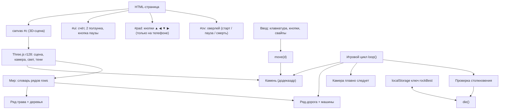
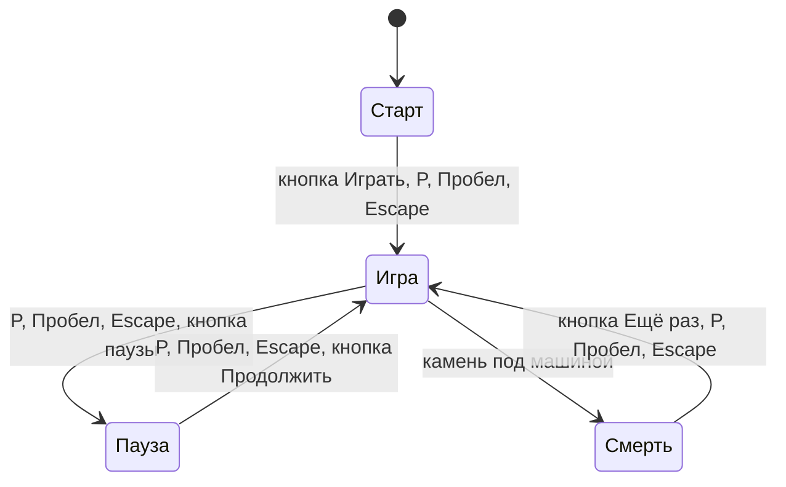
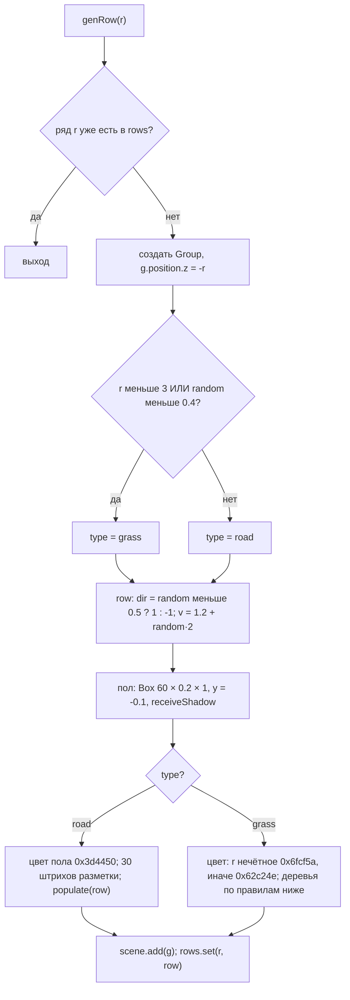
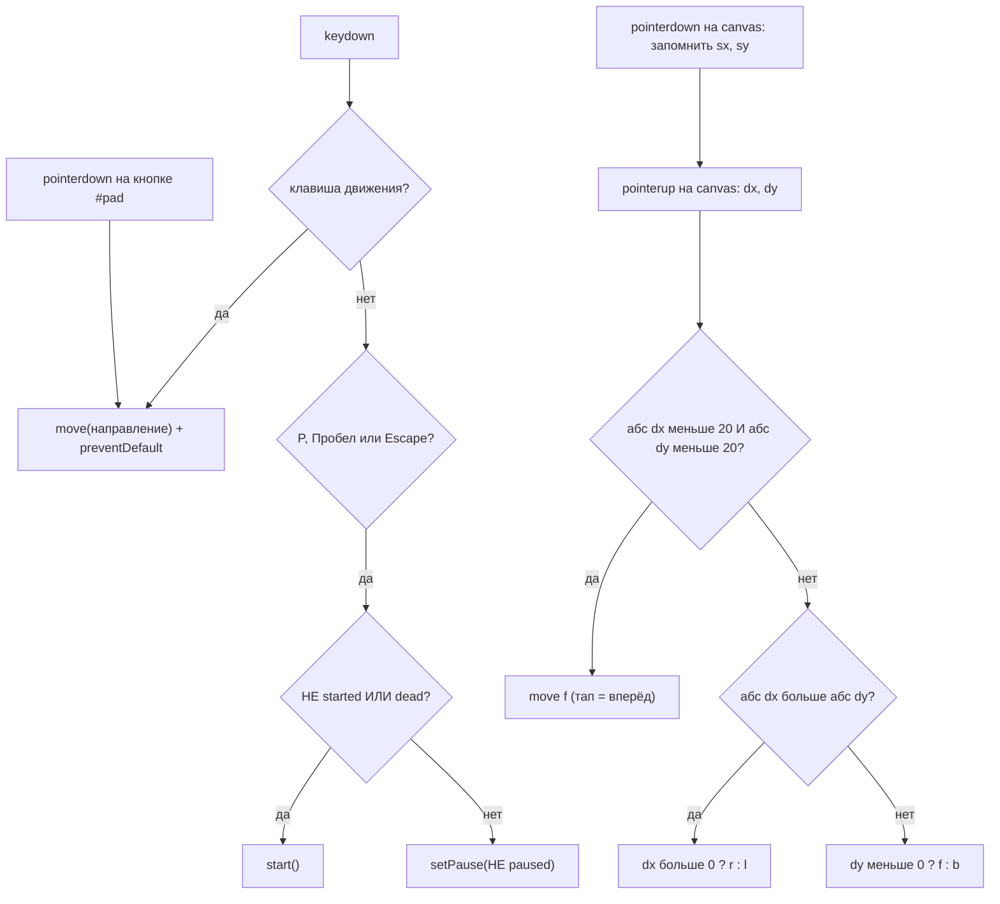
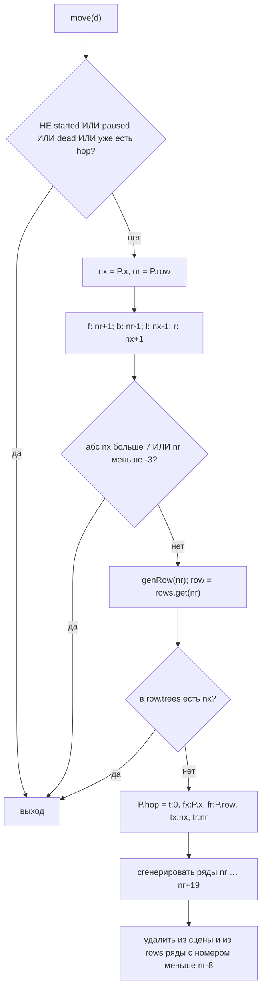
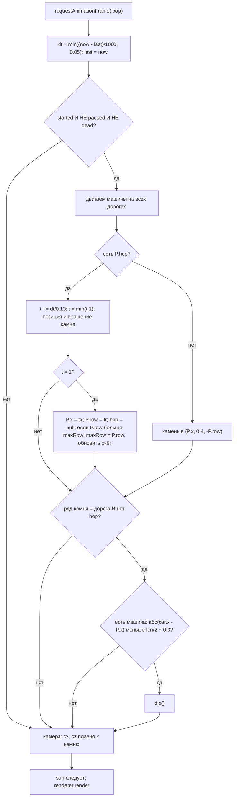

# SimDwayneDouglasJohnson-The-Rock-
# 🪨 Симулятор камня — полная блок-схема и спецификация

**Как использовать с ИИ.** Отдать ИИ этот документ целиком и написать:

> Сделай игру строго по этой спецификации: один файл `Симулятор камня.html`, Three.js r128 с `https://cdnjs.cloudflare.com/ajax/libs/three.js/r128/three.min.js`. Не меняй числа, цвета, тексты и порядок действий. Ничего не добавляй от себя.

**Система координат.** Ряд `r` лежит в `z = -r` (вперёд = в сторону -z). Клетка по горизонтали = `x`. Одна клетка = 1 единица. Камень стоит в `(x, 0.4, -r)`.

---

## 1. Из чего состоит игра



## 2. Состояния игры



## 3. Переменные состояния

| Переменная | Старт | Смысл |
| --- | --- | --- |
| `W` | 8 | константа, полуширина мира |
| `rows` | пустой Map | номер ряда → объект ряда |
| `speed` | 1 | множитель скорости машин (ползунок) |
| `density` | 3 | машин на дороге (ползунок) |
| `paused`, `started`, `dead` | false | флаги |
| `maxRow` | 0 | счёт = самый дальний ряд |
| `best` | из localStorage `rockBest`, иначе 0 | рекорд (чтение в try/catch) |
| `P` | `{x:0, row:0, hop:null}` | позиция камня в клетках и текущий прыжок |
| `cx, cz` | 0, 0 | сглаженная точка, за которой едет камера |
| `last` | `performance.now()` | время прошлого кадра |

Объект ряда: `{ r, type ('grass'|'road'), g (THREE.Group), cars: [], trees: Set<x>, dir (1 или -1), v (скорость) }`. Объект прыжка `P.hop`: `{ t:0, fx, fr, tx, tr }` (откуда x, откуда ряд, куда x, куда ряд).

---

## 4. Сцена, свет, камера

| Параметр | Значение |
| --- | --- |
| Renderer | `WebGLRenderer({canvas, antialias:true})`, `setPixelRatio(min(devicePixelRatio, 2))`, `shadowMap.enabled = true` |
| Фон сцены | `0xbfe3f5` |
| Туман | `Fog(0xbfe3f5, 18, 40)` |
| Камера | `PerspectiveCamera(50, aspect, 0.1, 100)` |
| Ambient свет | `0xffffff`, интенсивность 0.65 |
| Directional свет («солнце») | `0xffffff`, 0.8, старт `(6,12,6)`, `castShadow = true` |
| Камера теней солнца | left/bottom = -14, right/top = 14 |
| `sun` и `sun.target` | оба добавлены в сцену |
| Resize | `setSize(innerWidth, innerHeight)`, `aspect = innerWidth/innerHeight`, `updateProjectionMatrix()`; вызывается на `resize` и один раз при старте |
| Материалы | везде `MeshLambertMaterial({color})` (функция `M(color)`) |

## 5. Камень

| Параметр | Значение |
| --- | --- |
| Геометрия | `DodecahedronGeometry(0.4, 0)` |
| Материал | `MeshLambertMaterial`, цвет `0x8a8d91`, `flatShading: true` |
| `castShadow` | true |
| Позиция в покое | `(P.x, 0.4, -P.row)` |
| Прыжок | длится **0.13 с**, высота дуги **0.6** (`y = 0.4 + sin(t·π)·0.6`) |
| Вращение в прыжке | каждый кадр `rotation.x -= (tr-fr)·dt·20`, `rotation.z -= (tx-fx)·dt·20` |
| После приземления | вращение остаётся как есть (не сбрасывается) |
| Смерть | `scale.y = 0.2`, `position.y = 0.1` |
| Сброс (reset) | `scale (1,1,1)`, позиция `(0, 0.4, 0)` |

## 6. Мир: создание ряда `genRow(r)`



**Результат:** в первых рядах (r = 0, 1, 2) всегда трава. Дальше 60 % рядов — дорога, 40 % — трава.

### 6.1 Разметка дороги

Для `x = -30; x < 30; x += 2` — `Box(0.8, 0.02, 0.06)`, цвет `0xdddddd`, позиция `(x, 0.005, 0)`.

### 6.2 Деревья на траве

Цикл `x` от -12 до 12 включительно. Дерево ставится, если выполнено любое из:

- `abs(x) > 8`
- `abs(x) > 7` (то есть x = ±8)
- `r ≥ 3` И `random < 0.2` И `x ≠ 0`

**Исключение:** если `r < 3` и `abs(x) ≤ 8` — дерево пропускается. Итого: в рядах 0–2 деревья только на краях (|x| от 9 до 12). В рядах от 3 — стена на краях (|x| ≥ 8) + 20 % случайных деревьев внутри (|x| ≤ 7), кроме x = 0. Каждый x с деревом добавляется в `row.trees`.

**Модель дерева** (Group, `position.x = x`, всё `castShadow`):

| Часть | Геометрия | Цвет | Позиция y |
| --- | --- | --- | --- |
| Ствол | `Box(0.2, 0.4, 0.2)` | `0x7a5230` | 0.2 |
| Крона | `Cone(0.4, h+0.5, 6)` | `0x2e8b3d` | `0.4 + (h+0.5)/2` |

`h = 0.5 + random·0.6` (случайная для каждого дерева).

## 7. Машины

**`makeCar()`** — Group. `len = 1 + random·0.9`. Цвет случайно из: `0xd63031, 0x0984e3, 0xfdcb6e, 0x00b894, 0x6c5ce7, 0xe17055`.

| Часть | Геометрия | Цвет | Позиция |
| --- | --- | --- | --- |
| Кузов | `Box(len, 0.4, 0.7)` | цвет машины | y = 0.35 |
| Кабина | `Box(len·0.5, 0.3, 0.6)` | `0xdfe6e9` | y = 0.7 |
| 2 колеса | `Box(0.25, 0.25, 0.8)` (одна геометрия, один материал) | `0x222222` | x = ±0.3·len·1.2 (то есть ±0.36·len), y = 0.15, z = 0 |

Порядок добавления: сначала колёса, потом кузов и кабина. Все части `castShadow`. У группы сохраняется `g.len = len`.

**`populate(row)`** (создание машин на дороге):

1. Удалить из `row.g` все старые машины, `row.cars = []`.
2. `n = density`, `span = 2·(W+6) = 28`.
3. Для `i = 0 … n-1`: `x = -W-6 + (i + random·0.6)·span/n` (то есть от -14), `y = 0, z = 0`.
4. `rotation.y = (dir > 0) ? 0 : π`.
5. Добавить в `row.g` и в `row.cars`.

**Движение машин (каждый кадр, пока игра идёт):** `car.x += row.dir · row.v · speed · dt`. Если `x > 14` → `x = -14`. Если `x < -14` → `x = 14`. (14 = W + 6; машины ездят по кругу.)

## 8. Управление и ввод



| Действие | Клавиши / элемент |
| --- | --- |
| Вперёд `f` | ↑, W, кнопка ▲ |
| Назад `b` | ↓, S, кнопка ▼ |
| Влево `l` | ←, A, кнопка ◀ |
| Вправо `r` | →, D, кнопка ▶ |
| Пауза / старт | P, Пробел, Escape (`e.preventDefault()`) |
| Кнопка «⏸ Пауза» | если НЕ started или dead → `start()`, иначе `setPause(!paused)` |

Клавиши сравниваются в нижнем регистре (`e.key.toLowerCase()`: `arrowup, arrowdown, arrowleft, arrowright, w, a, s, d, p, ' ', escape`).

## 9. Прыжок `move(d)`



Границы: камень ходит по `x` от -7 до 7 и по рядам от -3 вперёд без предела.

## 10. Игровой цикл `loop(now)`



**Прыжок по формулам** (`t` от 0 до 1):

- `x = fx + (tx - fx)·t`
- `y = 0.4 + sin(t·π)·0.6`
- `z = -(fr + (tr - fr)·t)`

**Столкновение:** проверяется только когда камень стоит (не в прыжке), каждый кадр, только в его ряду. Попадание = `abs(car.position.x - P.x) < car.len/2 + 0.3`.

**Камера и солнце (каждый кадр, даже на паузе и после смерти):**

```
tx = rock.position.x;  tz = rock.position.z
cx += (tx - cx) · min(dt·4, 1)
cz += (tz - cz) · min(dt·4, 1)
cam.position.set(cx·0.5 + 4, 8, cz + 6)
cam.lookAt(cx·0.5, 0, cz - 1.5)
sun.position.set(cx + 6, 12, cz + 6)
sun.target.position.set(cx, 0, cz)
```

## 11. Функции жизненного цикла

**`reset()`**

1. Удалить из сцены все `rows[*].g`, очистить `rows`.
2. `P.x = 0; P.row = 0; P.hop = null; maxRow = 0; dead = false`.
3. Камень: `scale (1,1,1)`, `position (0, 0.4, 0)`.
4. `genRow(r)` для `r` от -4 до 23.
5. Счёт на экране = 0.

**`start()`** — `reset()`; `started = true; paused = false`; скрыть оверлей; текст кнопки паузы «⏸ Пауза».

**`setPause(p)`** — если НЕ started или dead → выход. `paused = p`. Текст кнопки: `p ? '▶ Продолжить' : '⏸ Пауза'`. Если `p = true`: в оверлей записать заголовок «⏸ Пауза», текст «Можно менять скорость и количество машин», кнопку «Продолжить» (`id="go"`, клик → `setPause(false)`); показать оверлей (`display:flex`), поставить оверлею `pointer-events:none`, а кнопке `pointer-events:auto` (чтобы ползунки были доступны). Если `p = false`: скрыть оверлей.

**`die()`**

1. `dead = true`; `rock.scale.y = 0.2`; `rock.position.y = 0.1`.
2. Если `maxRow > best`: `best = maxRow`, обновить экран, сохранить в `localStorage` ключ `rockBest` (в try/catch).
3. Оверлей: «💥 Раздавлен!», «Счёт: N», кнопка «Ещё раз» (`id="go"`, клик → `start`); показать (`display:flex`).

**Ползунки**

- `#spd` (min 0.3, max 3, step 0.1, value 1): `speed = значение`; подпись `speed.toFixed(1) + '×'`.
- `#den` (min 0, max 8, step 1, value 3): `density = значение`; подпись = число; сразу вызвать `populate(row)` для всех рядов-дорог (в том числе на паузе).

**Порядок запуска:** создать renderer, сцену, камеру, свет → `resize()` → материалы, `W`, `rows`, переменные → рекорд из localStorage → камень → функции → обработчики → `reset()` → `requestAnimationFrame(loop)`. Игра не идёт, пока не нажали «Играть» (виден оверлей).

---

## 12. Интерфейс (HTML)

```
<canvas id="c">
<div id="ui">
  <div class="box">Счёт: <span id="score">0</span> · Рекорд: <span id="best">0</span></div>
  <div class="box"><label>Скорость машин: <b id="sv">1.0×</b><input id="spd" type="range" min="0.3" max="3" step="0.1" value="1"></label></div>
  <div class="box"><label>Машин на дороге: <b id="dv">3</b><input id="den" type="range" min="0" max="8" step="1" value="3"></label></div>
  <button id="pause">⏸ Пауза</button>
</div>
<div id="pad">  (сетка 3×2)
  [пусто] [▲ data-d="f"] [пусто]
  [◀ data-d="l"] [▼ data-d="b"] [▶ data-d="r"]
</div>
<div id="ov">
  <h1>🪨 Симулятор камня</h1>
  <p>Перейди дорогу и не попади под машину</p>
  <p>Стрелки / WASD — прыжок · P или Пробел — пауза</p>
  <button id="go">Играть</button>
</div>
```

Порядок в `body`: canvas → #ui → #pad → #ov → скрипт Three.js → основной скрипт. `<html lang="ru">`, `<title>Симулятор камня</title>`, viewport `width=device-width, initial-scale=1, viewport-fit=cover`.

## 13. Стили (CSS)

```css
:root{--bg:#bfe3f5;--panel:rgba(255,255,255,.88);--fg:#1d2730;--ac:#e0662d;box-sizing:border-box;padding-top:env(safe-area-inset-top,0px);padding-bottom:env(safe-area-inset-bottom,0px)}
@media (prefers-color-scheme:dark){:root:not([data-theme="light"]){--bg:#1c2a3a;--panel:rgba(25,32,42,.88);--fg:#e8eef4}}
:root[data-theme="dark"]{--bg:#1c2a3a;--panel:rgba(25,32,42,.88);--fg:#e8eef4}
html,body{height:100%;margin:0;overflow:hidden;background:var(--bg);font-family:system-ui,-apple-system,"Segoe UI",sans-serif;color:var(--fg);touch-action:none}
canvas{display:block;position:absolute;inset:0;width:100%;height:100%}
#ui{position:absolute;top:env(safe-area-inset-top,0px);left:0;right:0;display:flex;flex-wrap:wrap;gap:10px;align-items:center;padding:10px;pointer-events:none}
.box{background:var(--panel);border-radius:12px;padding:8px 12px;pointer-events:auto;font-size:14px;box-shadow:0 2px 8px rgba(0,0,0,.2)}
.box label{display:flex;flex-direction:column;gap:2px;font-size:12px}
input[type=range]{width:120px;accent-color:var(--ac)}
#score{font-size:22px;font-weight:700}
button{font:inherit;border:0;border-radius:10px;background:var(--ac);color:#fff;padding:8px 14px;cursor:pointer;font-weight:600}
#ov{position:absolute;inset:0;display:flex;flex-direction:column;align-items:center;justify-content:center;gap:12px;background:rgba(0,0,0,.45);color:#fff;text-align:center;padding:20px}
#ov h1{margin:0;font-size:clamp(30px,8vw,56px)}
#ov p{margin:0;opacity:.9}
#pad{position:absolute;bottom:calc(env(safe-area-inset-bottom,0px) + 14px);right:14px;display:grid;grid-template-columns:repeat(3,54px);gap:6px}
#pad button{height:54px;font-size:22px;padding:0;opacity:.85}
@media (hover:hover) and (pointer:fine){#pad{display:none}}
```

`#pad` скрыта на компьютере (мышь), видна на телефоне.

---

## 14. Особенности оригинала (повторить как есть)

1. Кнопка «⏸ Пауза» лежит внутри `#ui` с `pointer-events:none`, поэтому клик мышью по ней не срабатывает. Пауза работает через P / Пробел / Escape. *(Если нужна рабочая кнопка — добавь ей `pointer-events:auto`. Это отклонение от оригинала.)*
2. После паузы у `#ov` остаётся `pointer-events:none`, поэтому кнопка «Ещё раз» после смерти в такой игре не кликается. Работают P / Пробел / Escape.
3. Столкновение проверяется только когда камень стоит. Во время прыжка через машину ничего не происходит.
4. Машина, подъехавшая к стоящему камню, тоже убивает его.
5. На паузе и после смерти камера и рендер продолжают работать.
6. Вращение камня после прыжка не сбрасывается.
7. Рекорд сохраняется только при смерти.
8. При изменении количества машин все дороги пересоздают машины заново (позиции случайны)